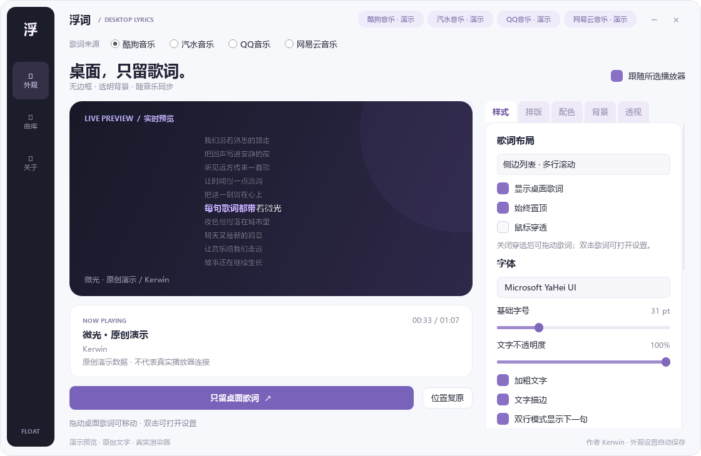
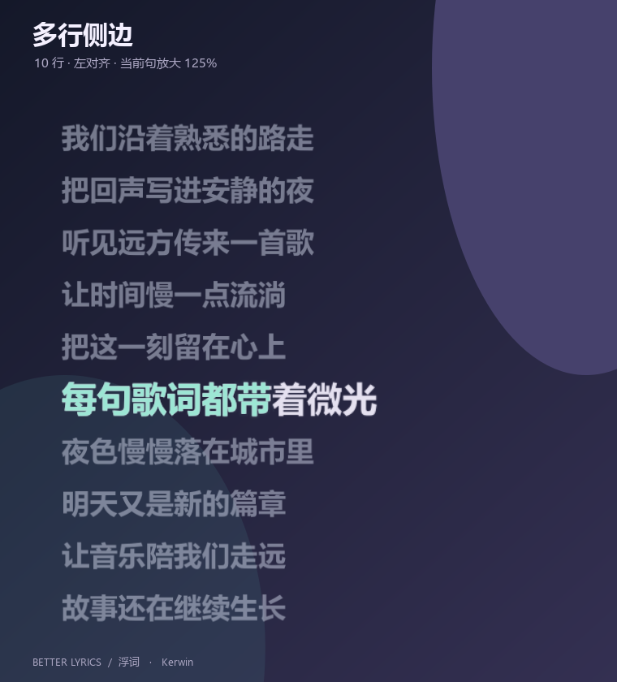
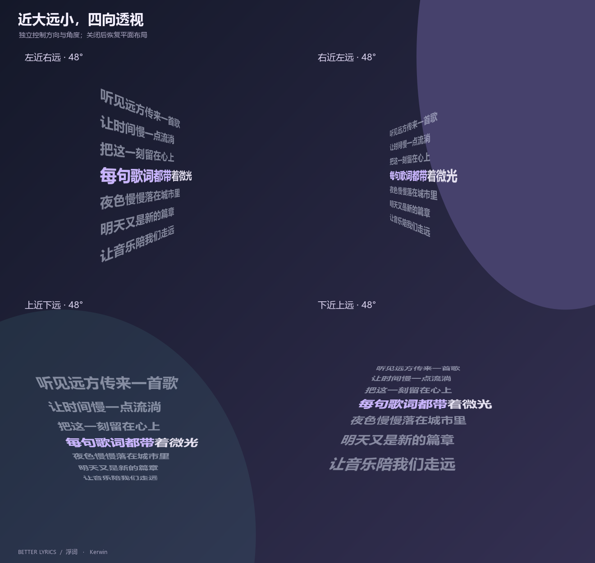
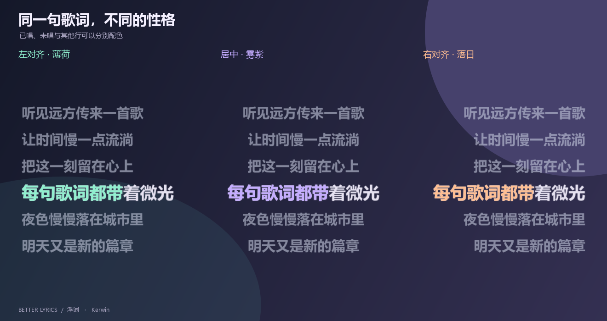
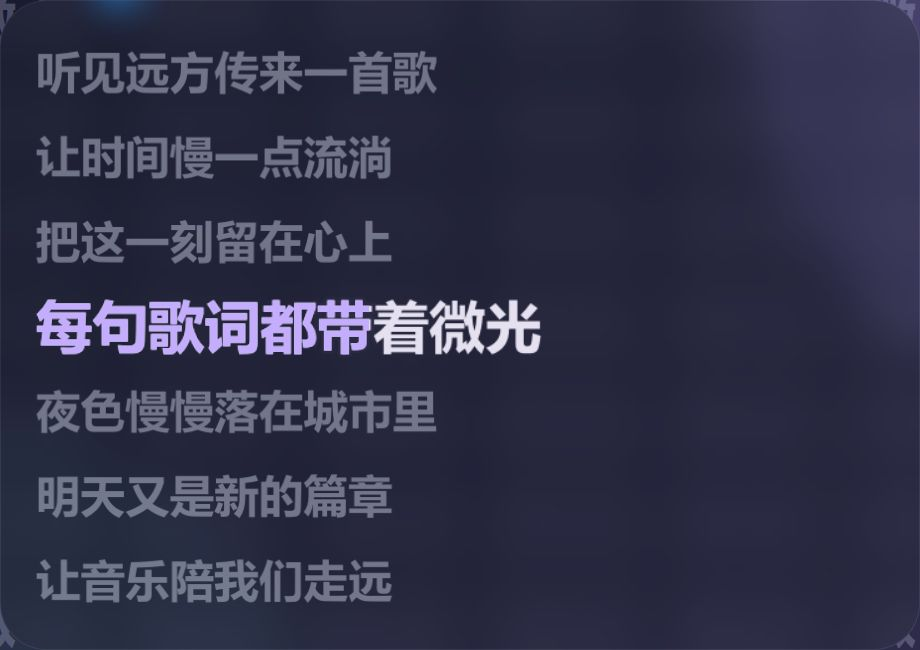
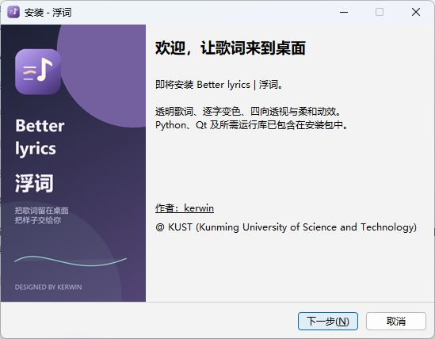

<p align="center"></p>
<h1 align="center">Better lyrics | 浮词</h1>
<p align="center">把歌词留在桌面，把样子交给你。</p>
<p align="center">Windows 桌面歌词 · 四播放器来源 · 逐字变色 · 3D 透视 · 波浪与聚焦动效</p>
<p align="center"><strong>作者：<a href="https://github.com/Kerwin0126">kerwin</a></strong><br>@ KUST (Kunming University of Science and Technology)<br><a href="mailto:kerwin126@foxmail.com">kerwin126@foxmail.com</a></p>
<p align="center"><a href="https://github.com/Kerwin0126/Better-lyrics/releases">下载安装</a> · <a href="docs/DEPLOYMENT.md">源码部署 / 打包教程</a> · <a href="https://github.com/Kerwin0126/Better-lyrics/issues">反馈问题</a> · <a href="LICENSE">非商业署名许可</a></p>

浮词是一款独立的透明桌面歌词显示器，可选择酷狗音乐、QQ 音乐、汽水音乐或网易云音乐作为来源。你可以把歌词摆在屏幕边缘、中央或自己喜欢的位置。

**本项目采用附带非商业限制的源码公开许可，不是 OSI 定义的开源软件。** 允许非商业学习、使用、修改和分享；须保留作者署名、许可和修改说明，禁止冒认原创、换壳销售及未经授权的商业利用。完整条款见 [LICENSE](LICENSE)。第三方组件继续适用各自许可。

## 看看效果

下图来自真实界面和同一套歌词渲染器。展示使用原创示例文字和隔离演示数据，不包含他人的完整歌词或播放器缓存；播放器状态标为演示。GIF 首次加载可能需要几秒。



### 双行悬浮与多行侧边

双行适合简洁显示；多行列表默认十行，可设 1～24 行，调整当前句放大、行距、文字左／中／右对齐及区域位置。背景默认完全透明。

| 双行悬浮 | 多行侧边 |
| --- | --- |
|  |  |

### 近大远小的 3D 透视

四个透视方向、角度和平面旋转均可调。关闭透视回到平面，双行与多行布局均保留。



### 配色、对齐与逐字变色

已唱、未唱和其他行分别配色。KRC / QRC / YRC 使用实际字词时间，普通 LRC 缺少字词时间时按整句时长估算。



### 柔和放大与当前字波浪

可调放大强度、进入时长、波浪幅度和速度；两种动效可以叠加，暂停时波浪冻结。


### 全透明或圆角磨砂

不透明度 0% 时只留文字；调高后可启用圆角底色和 Windows 原生磨砂。下图的磨砂由 Windows 合成器实际显示后截取，效果受系统版本与透明设置影响。

| 全透明文字 | 原生圆角磨砂 |
| --- | --- |
|  |  |

## 普通用户：安装即可使用



1. 在 [Releases](https://github.com/Kerwin0126/Better-lyrics/releases) 下载 `BetterLyrics-Setup-版本号-x64.exe`。
2. 双击安装，选择安装位置和快捷方式。安装包包含 Python、Qt 及所需应用运行库，不需要另外安装开发环境。
3. 打开音乐播放器并播放歌曲，在浮词顶部选择相应来源。
4. 在「外观」调整效果；点击「只留桌面歌词」收起设置，双击歌词或点击托盘图标恢复。

目标平台：**Windows 10 / 11 x64**。当前实测为 Windows 11；其他系统、客户端版本和硬件配置可能存在差异。它是桌面程序，不需要服务器或 Docker。

安装包本身只有一个 EXE，安装后正常展开运行文件。若使用解压版，则需保留 `浮词.exe` 与 `_internal` 整个目录，不能只拷贝启动 EXE。

## 播放器适配

| 来源 | 歌曲与进度 | 歌词 |
| --- | --- | --- |
| 酷狗 | 主窗口与 MSAA 时间，使用有界插值 | 按配置发现本地 KRC |
| QQ | Windows SMTC 系统媒体会话 | 自动发现 QRC；必要时联网精确匹配 |
| 汽水 | SMTC 时间锚点加单调时钟，区分暂停、继续与拖动 | 优先只读 LunaCacheV2；兼容缓存明确记录的试听时长，必要时按曲目 ID 或精确条件取词 |
| 网易云 | 有效 SMTC 优先；无会话时从真正的主窗口识别歌曲，以 MSAA 进度比例结合时长定位 | 本地列表、历史和曲目库定位 ID，必要时联网获取 YRC / LRC |

**播放同步没有使用截图、OCR 或视觉识别。** MSAA 是系统辅助功能接口，SMTC 是系统媒体数据接口；截图仅用于本文档展示。

四种适配成熟度不完全相同：酷狗、QQ 的现有读取较稳定；汽水、网易云更依赖客户端版本及其数据接口。顶部「已打开」表示发现进程，「已连接」表示有有效歌曲及进度。播放卡片另列歌曲、进度、歌词三项状态。

安装盘符无需固定。酷狗从 `%APPDATA%\KuGou8\KuGou.ini` 的 `LyricPath` 读取缓存位置，QQ 读取其缓存配置，汽水和网易云读取当前用户的应用数据目录；不绑定作者的播放器安装盘符。

## 使用提示与常见问题

- **移动歌词**：取消鼠标穿透后拖动，定位后再打开穿透。
- **切换样式**：在「样式」选择双行或多行，在「透视」独立开关 3D。
- **手动预览**：打开「曲库」选歌词；重新勾选「跟随所选播放器」恢复自动同步。
- **进度等待**：先播放歌曲并展开播放器主窗口。精简模式、最小化到托盘或接口改版可能使控件不可用。网易云比例读取存在约一个像素的量化误差。
- **有进度没歌词**：可能是缓存未生成、无该版本歌词或联网失败，查看底部错误；程序会自动重试。
- **逐字颜色不准确**：检查底部是「逐字／词时间」还是「整句匀速估算」。LRC 本身没有逐字时间。
- **磨砂没出现**：背景不透明度须高于 0%，并勾选磨砂。不支持时保留半透明底色。
- **完全退出**：右键托盘图标选择「退出浮词」，关闭设置窗口只会收起设置。

来源与外观自动保存，启动时无需重新切换。数据位置、联网行为见 [数据说明](docs/PRIVACY.md)。

## 开发、部署与打包

完整步骤见 **[部署教程](docs/DEPLOYMENT.md)**。Windows PowerShell 最小流程：

```powershell
git clone https://github.com/Kerwin0126/Better-lyrics.git
cd Better-lyrics
py -3.14 -m venv .venv
.\.venv\Scripts\python.exe -m pip install -r requirements-build.txt
powershell.exe -NoProfile -ExecutionPolicy Bypass -File .\build_reader.ps1
powershell.exe -NoProfile -ExecutionPolicy Bypass -File .\build_backdrop.ps1
.\.venv\Scripts\python.exe desktop_lyrics.py
```

原生组件编译需要 MSVC C++ Build Tools 与 Windows SDK；普通安装版用户无需安装这些工具。

| 文件 | 作用 |
| --- | --- |
| `desktop_lyrics.py` / `studio_controls.py` | 设置界面与外观 |
| `lyric_renderer.py` | 透明文字、布局、透视、逐字颜色与动画 |
| `about_page.py` / `app_info.py` | 关于、作者与项目信息 |
| `playback_source.py` / `timeline_clock.py` | 来源、读取器生命周期与汽水时钟 |
| `MediaReader.cpp` / `PlaybackReader.cs` | 系统媒体与辅助功能读取 |
| `player_lyrics.py` / `soda_cache.py` / `lyric_data.py` | 歌词、只读缓存与时间格式 |
| `RoundedBackdrop.cpp` / `native_backdrop.py` | 原生圆角磨砂 |
| `build_exe.ps1` / `build_installer.ps1` | 应用与安装包构建 |

## 作者、许可与致谢

作者：[kerwin](https://github.com/Kerwin0126)  
@ KUST (Kunming University of Science and Technology)  
邮箱 **kerwin126@foxmail.com**。个人项目，学校信息仅为作者简介。

- 原创部分：[Kerwin 非商业署名许可 1.0](LICENSE)。修改版须标注来源与修改内容；换界面、改名字也不解除非商业限制。
- 第三方：[许可与致谢](THIRD_PARTY_NOTICES.md)。Qt / PySide6 / Shiboken、Python、QRC 解码代码及运行库保持各自许可。
- [数据说明](docs/PRIVACY.md) · [贡献说明](CONTRIBUTING.md) · [问题反馈](https://github.com/Kerwin0126/Better-lyrics/issues)。

禁止商用不属于 [OSI 开源定义](https://opensource.org/osd)。免费发布也不免除 Qt / LGPL 等第三方义务；对应版本源码入口与完整许可见第三方声明。
